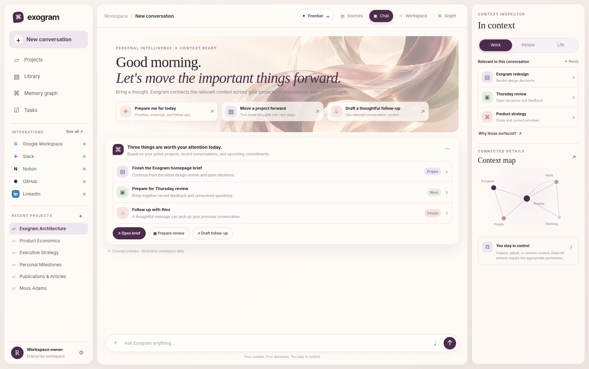

# Exogram Open-Core SDK & FastMCP Server (`v0.2.0`)

<p align="center">
  
</p>

<p align="center">
  <a href="https://pypi.org/project/exogram/"></a>
  <a href="https://pypi.org/project/mcp-server-exogram/"></a>
  <a href="https://www.npmjs.com/package/@exogram/sdk"></a>
  <a href="https://github.com/Richard-Ewing/exogram-protocol-rfc"></a>
  <a href="LICENSE"></a>
</p>

**Exogram** is the Personal Neural Network (`Work · People · Life`), Encrypted Memory Vault, and Deterministic Action Governance Engine for AI agents.

This open-core repository ships the runnable client libraries, local SQLite WAL engine, FastMCP server, and A2UI Living Tile JSON schemas:
- **`python/` (`exogram` v0.2.0)** — Python SDK with **Zero-Signup Local SQLite WAL Mode** (`~/.exogram/vault.db`) and Cloud API routing (`https://api.exogram.ai`).
- **`typescript/` (`@exogram/sdk` v0.2.0)** — TypeScript & Node.js SDK with CJS/ESM/DTS builds and zero-signup local mode.
- **`mcp-server/` (`mcp-server-exogram` v0.2.0)** — FastMCP Server for Claude Desktop, Cursor, Google Antigravity, and OpenAI Agents.
- **`schemas/living-tiles-v5.schema.json`** — Canonical JSON Schema for all Composable A2UI Living Tiles and the 6 First-Party Kernels.

---

## 60-Second Zero-Signup Quickstart (Local SQLite WAL & Cloud)

Every SDK and MCP tool runs immediately on your machine using an embedded **SQLite WAL vault (`~/.exogram/vault.db`)** with **zero account signup or API key required**. When you set `EXOGRAM_API_KEY`, the exact same code routes to **Exogram Cloud (`https://exogram.ai`)**.

### 1. Run the Python SDK in 30 Seconds

```bash
pip install exogram
# Or install directly from source:
pip install git+https://github.com/Richard-Ewing/exogram-sdk.git
```

```python
from exogram import ExogramClient

# Automatically initializes ~/.exogram/vault.db (SQLite WAL) when no API key is set,
# or routes to https://api.exogram.ai when api_key="exo_live_..." or EXOGRAM_API_KEY is set.
client = ExogramClient()

# 1. Store memory claims across Work, People, and Life spheres
record = client.vault.store(
    "Architecture decision: Production edge deploys to Cloudflare Workers via OpenNext",
    namespace="work",
    sphere="Work",
    confidence=0.98,
    temporal_horizon="durable_trait",
)
print(f"Stored {record.id} | State Hash: {record.state_hash}")

# 2. Traverse the Personal Neural Network (Infinite-Hop Spreading Activation + HippoRAG 2 PPR)
context = client.neural_network.retrieve(
    query="How does our production edge deploy?",
    spheres=["Work", "People", "Life"],
    max_hops=4,
)
print(f"PPR Converged: {context.ppr_converged} | Claims: {len(context.claims)}")

# 3. Deterministic 0.07ms State-Hash & Instinct Pre-Mutation Action Gate
judgment = client.governance.evaluate_action(
    agent_id="deployment-sentinel",
    action_type="deploy_cloudflare_worker",
    parameters={"service": "exogram-edge", "environment": "production"},
    state_hash=context.state_hash,
)

if judgment.permitted:
    receipt = client.actions.execute(judgment.execution_token)
    print(f"Committed! Ledger Hash: {receipt.ledger_hash}")
```

Or run the self-contained demo script directly from this repository:

```bash
python examples/quickstart_local_and_cloud.py
```

### 2. Connect Claude Desktop, Cursor, or Antigravity via FastMCP (`<30s`)

#### Option A: Zero-Signup Local SQLite WAL Mode (`~/.exogram/vault.db`)

```json
{
  "mcpServers": {
    "exogram": {
      "command": "uvx",
      "args": ["mcp-server-exogram", "--local"]
    }
  }
}
```

#### Option B: Hosted Exogram Cloud MCP (`https://exogram.ai/api/mcp`)

```json
{
  "mcpServers": {
    "exogram": {
      "command": "uvx",
      "args": ["mcp-server-exogram"],
      "env": {
        "EXOGRAM_API_KEY": "exo_live_your_key_here",
        "EXOGRAM_API_URL": "https://api.exogram.ai"
      }
    }
  }
}
```

### 3. TypeScript / Node.js Quickstart (`@exogram/sdk`)

```bash
npm install @exogram/sdk
```

```typescript
import { ExogramClient } from '@exogram/sdk';

const client = new ExogramClient(); // Zero-signup local mode or pass { apiKey: process.env.EXOGRAM_API_KEY }

const rec = await client.vault.store('Deploy target is Cloudflare Workers Global Edge', {
  namespace: 'work',
  sphere: 'Work',
  confidence: 0.96,
});

const context = await client.neuralNetwork.retrieve('What is our deploy target?', {
  spheres: ['Work', 'People', 'Life'],
  maxHops: 4,
});

const judgment = await client.governance.evaluateAction({
  agentId: 'ts-agent',
  actionType: 'deploy_worker',
  parameters: { target: 'cloudflare' },
  stateHash: context.stateHash,
});

if (judgment.permitted && judgment.executionToken) {
  const receipt = await client.actions.execute(judgment.executionToken);
  console.log('Committed Ledger Hash:', receipt.ledgerHash);
}
```

---

## Architecture Overview (Master Plan v5)

```
┌──────────────────────────────────────────────────────────────────────────────┐
│                     User Prompt / External MCP Agent Call                    │
└──────────────────────────────────────┬───────────────────────────────────────┘
                                       ▼
┌──────────────────────────────────────────────────────────────────────────────┐
│ 1. Laya System 1 Deterministic Fast-Path (<15ms In-Memory Understanding)     │
│    Resolves vault subjects, intent, sphere routing (Work · People · Life),   │
│    and search queries in <15ms over profileDigest + priorTurns.              │
└──────────────────────────────────────┬───────────────────────────────────────┘
                                       ▼
┌──────────────────────────────────────────────────────────────────────────────┐
│ 2. Personal Neural Network (Infinite-Hop Spreading Activation + HippoRAG 2)  │
│    • Hybrid RRF Retrieval (Vector + BM25 + Entity Overlap)                   │
│    • Personalized PageRank (PPR, damping α = 0.85) across multi-hop edges    │
│    • 3-Horizon Episodic Memory (ephemeral_episode, recurring_event, durable) │
│    • Read-Time/Write-Time Scalar Conflict Supersession & /api/memory/undo    │
└──────────────────────────────────────┬───────────────────────────────────────┘
                                       ▼
┌──────────────────────────────────────────────────────────────────────────────┐
│ 3. Two-Tier Inference Gateway & 6 Honest First-Party Kernels                 │
│    • PERSONAL Subtasks → Paid Gemini 3.x (Zero PII leaves encrypted boundary)│
│    • PUBLIC_ONLY Subtasks → PII-stripped & compressed before Free-Token Pool │
│    • Post-Synthesis Citation Verification (Complete · Cited vs Standby)      │
└──────────────────────────────────────┬───────────────────────────────────────┘
                                       ▼
┌──────────────────────────────────────────────────────────────────────────────┐
│ 4. Instinct Pre-Mutation Governance (0.07ms Gate) & A2UI Living Tiles        │
│    • Deterministic SHA-256 State-Hash Drift Guard before any tool mutation   │
│    • Progressive JSON Patching (AG-UI) & Claim-Predicate Entailment Scoring  │
└──────────────────────────────────────────────────────────────────────────────┘
```

### The 6 First-Party Cognitive Kernels

Every turn is orchestrated by six specialized first-party kernels and audited by `verifyAgentContributionsAgainstTurnOutput` so only kernels whose outputs are genuinely cited in the final synthesis display **`Complete · Cited`**:

| Kernel | Responsibility |
| :--- | :--- |
| **`Neural Graph Kernel`** | Traverses multi-hop associative paths across `Work`, `People`, and `Life` using Spreading Activation and HippoRAG 2 Spectral PPR. |
| **`Generative UI Kernel`** | Synthesizes and validates Composable A2UI Living Tiles against `schemas/living-tiles-v5.schema.json`. |
| **`Live Web & Places Scout`** | Executes PII-stripped public web & place verification for `PUBLIC_ONLY` subtasks. |
| **`Action & Draft Kernel`** | Prepares governed emails, calendar events, and external tool mutations gated by the `0.07ms` Instinct Action Gate. |
| **`Analytical Synthesis Kernel`** | Performs multi-constraint reasoning, tradeoff matrices, and structured comparisons. |
| **`Grounded Citation Kernel`** | Enforces contrastive claim-predicate entailment (`scoreClaimPredicateEntailment`) and Perplexity-style `[1]`, `[2]` citations. |

### Composable A2UI Living Tiles (`schemas/living-tiles-v5.schema.json`)

Exogram dispatches structured inline Living Tiles validated for epistemic provenance:
- `action_draft` — Governed outbound drafts (email, message, calendar, PR) with approval controls.
- `checklist` — Interactive execution checklists anchored to vault goals.
- `decision_matrix` — Multi-criteria weighted scoring tables.
- `curated_places` — Grounded venue & location cards with verified ratings.
- `comparison_table` — Side-by-side technical or product breakdowns.
- `retail_deals_tile` — Verified merchant pricing and availability cards.
- `media_watch_tile` — Film, series, book, and podcast recommendations with streaming provenance.
- `occasion_countdown_tile` — Recurring event (`RRULE:FREQ=YEARLY`) countdowns and preparation steps.
- `memory_undo_tile` — Transparent memory consolidation card with one-click `/api/memory/undo`.
- `agent_hud_tile` — Real-time telemetry of the 6 First-Party Kernels (`Complete · Cited` vs `Standby`).
- `branded_diagram_tile` — Publication-grade Plum Mineral (`#FAF7F2`, `#201B20`, `#4C2B4B`, `#AEBD9A`) SVG diagrams.
- `hyperframes_video_tile` — Frame-accurate deterministic HTML/CSS/SVG motion briefings (`window.__renderFrame`).
- `instinct_computer_tile` — Stateful browser/errand operator HUD with `Approve Step` and `Take Over` controls.

---

## Repository Structure & Verification

```text
exogram-sdk/
├── python/                  # Official Python SDK (pip install exogram)
├── typescript/              # Official TypeScript SDK (npm install @exogram/sdk)
├── mcp-server/              # FastMCP Server (uvx mcp-server-exogram)
├── schemas/                 # JSON Schemas (living-tiles-v5.schema.json)
├── examples/                # Runnable Local & Cloud Quickstart scripts
└── docs/assets/             # Plum Mineral UI previews & architecture diagrams
```

### Run the Test Suites Locally

```bash
# 1. Run the 60-second quickstart script
python examples/quickstart_local_and_cloud.py

# 2. Run Python SDK unit tests
pytest python/tests/

# 3. Run FastMCP Server unit tests
pytest mcp-server/tests/

# 4. Run TypeScript SDK unit tests
cd typescript && npm test
```

## License

MIT — see [LICENSE](LICENSE) for details.
